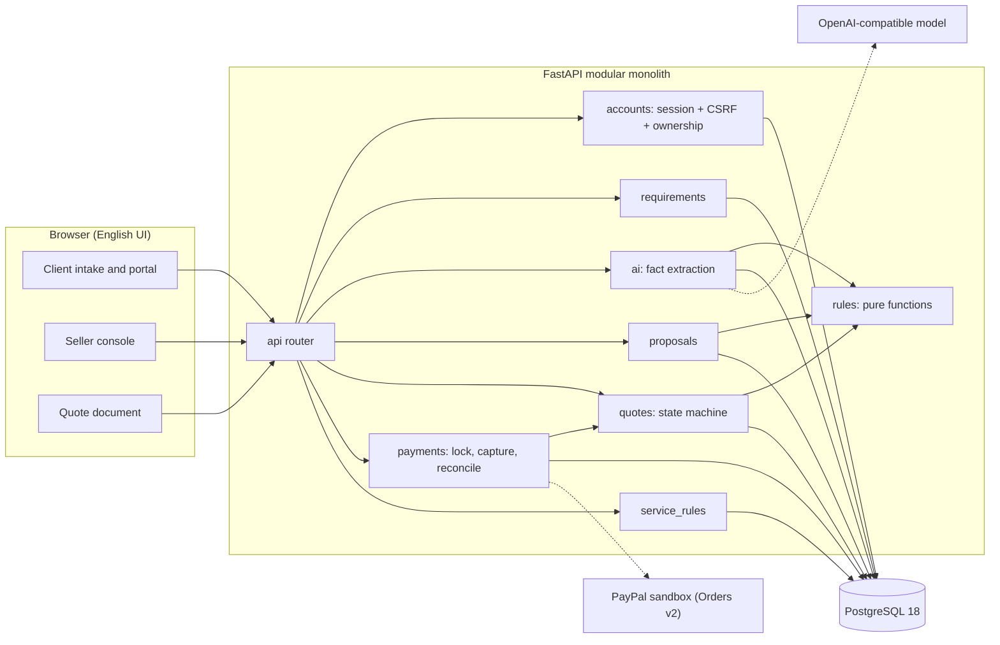

# ScopeBridge

<p></p>

**An agreement desk for freelance studio work.** ScopeBridge turns an ambiguous client request
into a priced, rule-checked scope, then carries that exact version through studio review, client
confirmation and a PayPal payment — with every amount traceable to a rule and every action
attributable to a signed-in account.

[](https://github.com/1634594707/ScopeBridge/actions/workflows/verify.yml)
[](LICENSE)


> **Status:** working prototype, PayPal **sandbox** only, no hosted demo — every step below runs
> from this repository. Known gaps are listed under [Known limitations](#known-limitations).


## At a glance

| Field | Detail |
| --- | --- |
| Flow | brief → facts → priced scopes → quote version → studio review → client confirmation → settlement |
| Authority | the model proposes · `app/rules/` prices · the studio reviews · the client confirms |
| Stack | FastAPI, SQLAlchemy 2, Alembic, PostgreSQL 18 · React 18, TypeScript, Vite, Tailwind |
| External services | one OpenAI-compatible model (reads facts only), PayPal Orders v2 sandbox |
| Tests | `uv run pytest -q` — 114 tests, plus a 19-case comparative evaluation |
| Without credentials | the whole manual path works; model and payment fail explicitly, never silently |

## Why

Freelance web work fails in the gap between a vague request and a signed scope: the brief lives
in email, the price lives in a spreadsheet, and "confirmed" lives nowhere. ScopeBridge puts the
whole lifecycle in one place with an explicit division of authority:

> **The model may propose, but only a program prices, only a human reviews, and only the client
> confirms.**

Concretely:

- An AI model reads the client brief and returns **facts only** — pages, budget, deadline, assets,
  features — plus the questions it needs answered and the requests the studio cannot fulfil.
- A versioned rules layer (`app/rules/`) is the **only** place in the system allowed to produce an
  amount. No model output, client input or UI state can set a price.
- Quotes are immutable and versioned (`DRAFT → REVIEWED → CONFIRMED`, `SUPERSEDED` on change).
  The client confirms one exact version — not "the deal we discussed".
- Payment is PayPal Orders v2 (`create → approve → capture`), with the amount read from the
  confirmed quote on the server; the client never sends an amount. A capture is only believed
  after the server verifies it with PayPal, and the verified order is frozen into a read-only
  snapshot in the same transaction that marks the quote `PAID`.
- When PayPal's answer is unknown (timeout, lost response), the attempt is parked in
  `RECONCILING` — never guessed as success or failure — and recovered with the same
  `PayPal-Request-Id`.

| Seller console | Requirement workspace |
| --- | --- |
|  |  |
| **Quote with rule references** | **Client portal** |
|  |  |

## Feature highlights

- **Client-owned intake** — briefs belong to a signed-in client; every append carries
  `expected_revision` and stale writes get `409`.
- **AI fact extraction with a clarification gate** — the model's questions and unsupported
  requests become a clarification the client must confirm before any quote can be issued
  (`409 clarification_required` until then). Manual clarification is an explicit, labelled
  exception, never a silent bypass.
- **Rule-checked scopes** — up to two candidate scopes per revision, priced server-side;
  over-budget scopes stay on screen with their exact violation instead of being hidden.
- **Quote versions with diff** — reissued quotes show what changed line by line against the
  previous version.
- **Payments that lock before they call out** — the attempt and `PAYMENT_LOCKED` state are
  committed before the first PayPal call; only a verified capture writes `PAID` + `CLOSED` +
  snapshot in one transaction.
- **Recovery paths** — `RECONCILING` attempts are resolved by querying the original order,
  retrying the create with the same request id, or a written manual close that records who
  closed it and why.
- **Comparative evaluation** — 19 fixed cases compare the facts-and-rules pipeline against a
  one-shot "model quotes it" baseline, with unparseable answers counted as failures.
- **Local-first operation** — PostgreSQL in Docker; the model and PayPal sandbox are the only
  external services, and the manual path works with no credentials at all.

## Quickstart

**Prerequisites:** Docker Desktop, [uv](https://docs.astral.sh/uv/), Node 20+ with pnpm.

```bash
git clone https://github.com/1634594707/ScopeBridge.git
cd ScopeBridge

# 1) environment — set DATABASE_URL, POSTGRES_PASSWORD, SESSION_SECRET,
#    SELLER_EMAIL/PASSWORD, CLIENT_EMAIL/PASSWORD; optionally MODEL_* and PAYPAL_*.
#    APP_BASE_URL must match the browser origin (4173 preview / 5173 dev) because
#    PayPal sends the buyer back to that exact address.
cp .env.example .env

# 2) database (PostgreSQL 18 on host port 55433)
docker compose up -d

# 3) backend
cd backend
uv sync
uv run alembic upgrade head
uv run python -m app.seed        # seller + client accounts, rule v1, demo brief
uv run uvicorn app.main:app --port 8000

# 4) frontend (second terminal)
cd ../frontend
pnpm install
pnpm build && pnpm exec vite preview   # http://127.0.0.1:4173
```

Then follow the walkthrough below. The "PayPal never answered" recovery path is exercised by
`test_api_payment.py` and is reachable in the UI from `/console` → **Payment attention**.

### Demo walkthrough

1. **Client** — sign in at `/signin` (Client seat) with `CLIENT_EMAIL`/`CLIENT_PASSWORD`, submit
   a brief at `/start`.
2. **Studio** — sign in (Studio seat), open the brief from `/console`, optionally press
   **Draft with the model** to see the extracted facts and two priced options, then
   **Use this scope → Price this scope → Draft quote**.
3. On the quote page press **Review and issue**.
4. **Back as the client** — press **Confirm this version**, then **Continue to PayPal** and
   approve with a [Sandbox Personal account](https://developer.paypal.com/dashboard/accounts).
   PayPal returns to `/pay/<id>`, the server verifies the capture, and the quote becomes
   read-only with the order snapshot attached.

### Running without credentials

A judge with no model key and no PayPal credentials can still reach the whole UI: sign-in,
briefs, manual clarification, manual scope pricing, quotes, review and client confirmation all
work. The two unavailable steps fail **explicitly**, not silently:

- Model draft → `503 {"code":"model_not_configured"}` with instructions on the model card.
- Payment → `503 {"code":"paypal_not_configured"}` before the quote locks; the quote stays
  `CONFIRMED` and no attempt is created.

A full sandbox payment requires `PAYPAL_CLIENT_ID`/`PAYPAL_CLIENT_SECRET`. This is a working
prototype, not a hosted demo — judges run it from the repository.

## Architecture



- **Modular monolith, one-way dependencies**: `router → service → rules/models`. Cross-package
  calls go through services, never through another package's tables.
- **Pure decision layer**: `app/rules/` has no database, network or clock access (`today` is
  injected), so model output passes through the same pricing functions as a hand-typed scope.
  Verdicts are reproducible and unit-testable.
- **Money is integer minor units** (cents, USD) everywhere.

### Model boundary: facts, not proposals

The model returns a five-key fact sheet and nothing else; anything out of shape is rejected
whole and recorded, never coerced:

```json
{"pages": 3, "budget_usd": 500, "deadline_days": 21,
 "assets_ready": false, "features": ["landing_pages", "online_ordering"]}
```

`app/ai/candidates.py` builds at most two options — "As briefed" and, when that fails, a
one-page scope keeping only capabilities the studio actually offers — and `app/rules` prices
both. Measured against this gateway (2026-10-30, `deepseek-v4.1-flash`): a nested
scopes-in-answer prompt matched the schema 0/5 times and `response_format: json_schema` was
accepted but not enforced; the five-key sheet succeeded 5/5 at 2.1–3.2 s.

A richer prompt is the obvious alternative and was measured first: it failed here because the
gateway accepts a JSON schema without enforcing it, so a nested answer is plausible-looking and
still wrong. A flat five-key sheet is small enough that a malformed reply is detectable, which is
what lets the server reject an answer whole instead of repairing it.

## API surface

| Method | Path | Who |
| --- | --- | --- |
| `POST` | `/api/session` · `/api/client-session` · `GET /api/session` · `DELETE /api/session` | seller / client sign-in, session read, sign-out (CSRF) |
| `POST` | `/api/clients` | public — client registration, opens the first session |
| `GET` / `POST` | `/api/service-rules` · `/api/service-rules/estimate` | public — rules and estimator (prices a scope from pages + add-on codes only) |
| `POST` | `/api/requirements` | client (CSRF); the brief is owned by the signed-in client |
| `GET` / `DELETE` | `/api/requirements` · `/api/requirements/{id}` | seller; delete blocked once paid or in flight |
| `POST` | `/api/requirements/{id}/messages` | seller (CSRF) |
| `POST` / `GET` | `/api/requirements/{id}/extractions` (`.../latest`) | seller (CSRF) — model facts |
| `POST` | `/api/requirements/{id}/proposals` | seller (CSRF) |
| `POST` | `/api/requirements/{id}/clarifications/manual` | seller (CSRF) — only for model-unconfigured or a failed attempt |
| `POST` | `/api/portal/requirements/{id}/clarifications/{id}/confirm` | client + ownership (CSRF) |
| `POST` | `/api/requirements/{id}/quotes` | seller (CSRF); `409 clarification_required` without a confirmed clarification |
| `POST` | `/api/quotes/{id}/review` | seller (CSRF) |
| `GET` | `/api/portal/briefs` | client — the client's own briefs |
| `GET` / `POST` | `/api/portal/{requirement_id}` (`.../messages`) | client + ownership |
| `POST` | `/api/portal/.../proposals/{id}/select` · `.../quotes/{id}/confirm` | client + ownership (CSRF) |
| `POST` | `/api/portal/.../quotes/{id}/payment-attempts` | client + ownership (CSRF) + `Idempotency-Key` |
| `GET` / `POST` | `/api/portal/payments/{id}` (`.../capture`) | client + ownership |
| `POST` | `/api/payments/{id}/reconcile` · `/retry-create` · `/close` | seller (CSRF) |
| `GET` | `/api/payments/attention` | seller — `RECONCILING`/`FAILED` on quotes not yet `PAID` |
| `GET` | `/api/requirements/{id}/payments` · `/order` · `/api/orders/{id}` | seller |
| `GET` | `/api/health` | public |

Errors are always `{"code", "message", "details?"}` — no stack traces, SQL, tokens or internal
paths in responses.

## Tests and verification

```bash
cd backend
uv run pytest -q            # 114 tests
uv run ruff check .
```

| Suite | Covers |
| --- | --- |
| `test_pricing.py` / `test_feasibility.py` | pure rule layer: page pricing, budget gap, unsupported capability, lead time, missing info |
| `test_state_machine.py` | illegal quote transitions return `409`; confirmed quote superseded by brief change |
| `test_api_auth.py` | bad password, throttling, CSRF, two-sided sign-in, cross-account access |
| `test_api_quote_flow.py` | intake → scope → select → quote → review → confirm, revision supersession |
| `test_api_payment.py` | quote lock on attempt, idempotency replay/conflict, one snapshot per capture, amount mismatch stays `RECONCILING`, recovery, declines, expired quotes |
| `test_api_clarifications.py` | no clarification / unanswered / unsupported / manual / model-not-configured paths |
| `test_ai_extraction.py` | server-built options, model money ignored, malformed output rejected, evidence rows |
| `test_eval_cases.py` | replays the 19 fixed validation cases |

One-command isolated verification (its own compose project and volume, test placeholders, fake
PayPal adapter — no real credentials needed):

```powershell
powershell -ExecutionPolicy Bypass -File scripts/verify.ps1
```

`scripts/verify.sh` is the bash equivalent (CI runs it on `ubuntu-latest`). Browser smoke for the
no-credential path: `powershell -ExecutionPolicy Bypass -File scripts/e2e.ps1`.

## Comparative evaluation

Two arms, same briefs, same published terms, same model (`deepseek-v4.1-flash` via an
OpenAI-compatible gateway, prompt `facts-v7`, 19 fixed cases, one run each — recorded
2026-10-30, report `evals/reports/20261030T151055Z-facts-v7-inline-both.md`):

- **baseline** — one prompt asks the model for pages, add-ons, a total and a feasibility claim.
- **pipeline** — the model returns the five facts; the server builds at most two options and
  prices them.

| metric | baseline | pipeline |
| --- | --- | --- |
| parse rate | 18 / 19 | 19 / 19 |
| transport failures | 1 | 0 |
| claims the rules reject | 2 | n/a |
| wrong or missing price | 0 of the parsed | n/a (server prices) |
| unsafe releases (measured) | 2 | 0 |
| original request satisfied | n/a | 6 |
| narrowed option available | n/a | 6 |
| honest "no solution" | n/a | 7 |
| average latency | 4.3 s | 4.3 s |

Every rate names its denominator; failed calls count as failures. Re-run with
`uv run python ../evals/run_eval.py --runs 3 --workers 1 --timeout 120 --pause 2`.

## Repository map

```text
ScopeBridge/
├─ backend/             FastAPI app: rules layer, alembic migrations, 114 pytest tests
├─ frontend/            Vite + React + TypeScript + Tailwind; Playwright smoke in e2e/
├─ evals/               cases.json, run_eval.py, metrics.py, recorded reports
├─ docs/                architecture and workflow diagrams, screenshots
└─ scripts/             verify.ps1/.sh, e2e.ps1, isolated compose file
```

**Demo data.** The seeded database holds one real PayPal sandbox capture, order `5UL759133K5843017`,
$500.00. Screenshots that show fault states such as `verify:retry` were produced with a local
adapter; the committed build has no fault-injection switch, so those states cannot be forced from
the UI.

### Known limitations

- Sandbox-only payments; no webhooks, refunds or partial captures. An unclear capture is
  resolved by the seller via **Verify with PayPal**, create-retry, or a written manual close.
- No rate limits on registration/brief endpoints yet; add one before exposing publicly.
- Quote immutability is enforced in the application layer, not by database triggers.
- Model calls are single-attempt: an invalid answer returns `422` and the studio prices by hand.
  No automatic repair prompt; failures stay visible in the evidence table.
- `features` come back as free strings; unknown codes appear under "asked for but not offered"
  instead of being mapped silently.
- The demo price list is fictional — a product fixture, not a market rate.
- A paid brief is terminal: new work needs a new brief; a later brief revision supersedes open
  quote drafts rather than editing history.

## Diagrams

| Document | Contents |
| --- | --- |
| [docs/architecture.html](docs/architecture.html) | package boundaries: router → service → rules, and where the two external calls leave the process |
| [docs/workflow.html](docs/workflow.html) | the brief-to-payment lifecycle with every state a quote and a payment can hold |

Both are self-contained HTML files, and the same data is in `docs/architecture.json` and
`docs/workflow.json`. This README and those two pages are the whole documentation set: the
repository deliberately keeps no development log, demo script or decision-note folder, so anything
worth knowing lives next to the code that shows it.

## Contributing

Issues and pull requests are welcome. Before opening a PR:

```bash
cd backend && uv run pytest -q && uv run ruff check .
cd ../frontend && pnpm exec tsc -b && pnpm exec vite build
```

Report capability as implemented only when those commands actually pass. Comments and commit
messages are English; a non-trivial decision belongs in a comment next to the code, not in a
separate document. See [AGENTS.md](AGENTS.md) for the engineering rules this codebase follows.

## Security

Model and payment credentials live only in `.env`, which is git-ignored; `.env.example` carries
placeholders. Error responses return `{code, message, details?}` only — never tokens, sessions,
UIDs, IPs, file paths or raw exception text. When reporting a problem, open an issue without
credentials or personal data in it.

## License

[MIT](LICENSE) — the demo price list is fictional; PayPal marks appear only as the functional
integration they are.
