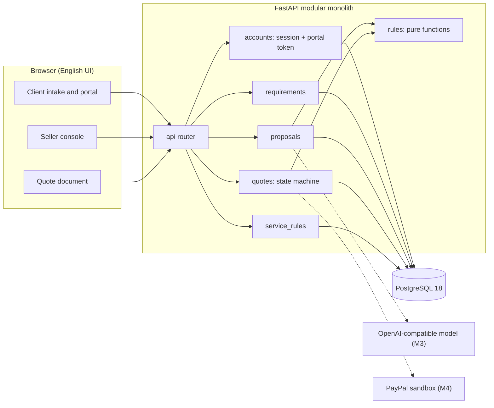

# ScopeBridge

**An agreement desk for studio work.** ScopeBridge turns an ambiguous client request into a priced,
rule-checked scope, then carries the exact same version through studio review, client confirmation
and (from M4) a PayPal sandbox payment.

The product is built around one idea: **the model may propose, but only a program prices, only a
human reviews, and only the client confirms.** Every line on a quote points back to the rule that
priced it and the client message that justified it.

> 中文设计文档：`docs/FORMAL_PROPOSAL.md`（正式方案）、`docs/DEVELOPMENT.md`（接口与里程碑）、
> `docs/architecture.html` / `docs/workflow.html`（架构图与流程图）。界面文案为英文。


---

## The demo in one paragraph

Maya asks for a three-page site with on-site ordering, a $500 budget, live in two weeks, no assets
ready. The studio prices two scopes: a one-page launch that includes an external ordering link
(within budget) and a two-page option with copywriting ($250 over). The over-budget scope stays on
screen with its exact violation instead of being hidden. Maya picks the feasible scope, the studio
reviews the quote, Maya confirms that version, and the quote becomes read-only. Any new client
message after that creates a new revision and supersedes open drafts — never edits history.

| Seller console | Requirement workspace |
| --- | --- |
|  |  |

| Quote (confirmed) | Client portal |
| --- | --- |
|  |  |

---

## What is implemented (M0–M2)

- **Versioned service rules** — base page, extra pages, add-ons, capability list, exclusions and
  lead time are stored as an immutable rule version; historical quotes keep their original numbers.
- **Public client intake** — a brief becomes a requirement with a private, single-requirement link.
- **Revisioned messages** — every append carries `expected_revision`; stale writes return `409`.
- **Rule-checked scopes** — the studio enters a scope (pages, add-ons, requested features, assets),
  and the server prices and judges it. Up to two candidate scopes per revision.
- **Client comparison** — feasible and infeasible scopes side by side, with budget delta, exclusions
  and explicit unsatisfied conditions.
- **Quote versions** — generated from a feasible scope with line items, rule references and source
  message references; `DRAFT → REVIEWED → CONFIRMED`, with `SUPERSEDED` on change.
- **Two identity paths** — seller session cookie + CSRF for writes; customer bearer token scoped to
  one requirement.
- **Local-first operation** — PostgreSQL in Docker, single operator account, no external services
  required to run the demo.

Not implemented yet (planned, see `docs/FORMAL_PROPOSAL.md`): AI extraction and proposal drafting
(M3), PayPal sandbox create/capture/reconcile (M4), evaluation suite at 20 cases (M5), demo video and
submission material (M6).

---

## Architecture



Dependency direction is one-way: `router → service → rules/models`. `app/rules/` has no database,
network or clock access — `today` is passed in — so the same functions will judge model output in M3.

Money is always integer minor units (cents) in USD. The client never sends an amount.

---

## Run it locally

**Prerequisites:** Docker Desktop, [uv](https://docs.astral.sh/uv/), Node 20+ with pnpm.

```bash
git clone git@github.com:1634594707/ScopeBridge.git
cd ScopeBridge

# 1) environment
cp .env.example .env          # then set POSTGRES_PASSWORD, SESSION_SECRET, SELLER_PASSWORD

# 2) database (PostgreSQL 18 on port 55433, isolated from any local instance)
docker compose up -d

# 3) backend
cd backend
uv sync
uv run alembic upgrade head
uv run python -m app.seed     # seller account, rule v1, one demo brief
uv run uvicorn app.main:app --port 8000

# 4) frontend (new terminal)
cd frontend
pnpm install
pnpm dev                      # http://127.0.0.1:5173
```

If `pnpm dev` fails on your machine with esbuild "Access is denied" errors, run the production bundle
instead — it is the same application, served by Vite's preview server:

```bash
cd frontend
pnpm build
pnpm exec vite preview        # http://127.0.0.1:4173
```

### Demo walkthrough

1. **Client** — open `/start`, submit a brief. You land on a private portal `/r/<token>`.
2. **Studio** — open `/signin`, use the seller credentials from `.env`
   (seed value in this repo's local `.env` is `seller@scopebridge.local` / `ScopeBridge-2026-demo`).
3. Open the brief in `/console`, price a scope on the right, then **Draft quote** from the priced
   option.
4. On the quote page press **Review and issue**.
5. **Back as the client** — open the private link, choose the scope, press **Confirm this version**.
   The quote turns read-only.

Try an infeasible scope too: three pages against a $500 budget returns
`Scope totals $700.00 against a budget of $500.00; short by $200.00.`

---

## API surface

| Method | Path | Who |
| --- | --- | --- |
| `POST` | `/api/session` · `DELETE /api/session` · `GET /api/session` | seller |
| `GET` | `/api/service-rules` | public |
| `POST` | `/api/requirements` | public intake (creates the portal token once) |
| `GET` | `/api/requirements` · `/api/requirements/{id}` | seller |
| `POST` | `/api/requirements/{id}/messages` | seller (CSRF) |
| `POST` | `/api/requirements/{id}/proposals` | seller (CSRF) |
| `POST` | `/api/requirements/{id}/quotes` | seller (CSRF) |
| `POST` | `/api/quotes/{id}/review` | seller (CSRF) |
| `GET` | `/api/portal` · `POST /api/portal/messages` | client token |
| `POST` | `/api/portal/proposals/{id}/select` | client token |
| `POST` | `/api/portal/quotes/{id}/confirm` | client token |
| `GET` | `/api/health` | public |

Errors are always `{"code", "message", "details?"}` — no stack traces, SQL or tokens.

---

## Tests

```bash
cd backend
uv run pytest -q            # 31 tests
uv run ruff check .
```

- `test_pricing.py` / `test_feasibility.py` — pure rule layer (three pages = 70000 cents, budget gap,
  unsupported capability, lead time, missing information).
- `test_state_machine.py` — every illegal quote transition returns `409`.
- `test_api_auth.py` — bad password, throttling, CSRF, unknown portal token, cross-seller access.
- `test_api_quote_flow.py` — intake → scope → select → quote → review → confirm, plus revision
  supersession.
- `test_eval_cases.py` — replays the five fixed cases in `evals/cases/`.

Fixture cases live in `evals/` with their expected verdicts; changing a rule means updating the case
first, not loosening the assertion.

---

## Engineering notes

- **Modular monolith** with domain packages (`accounts`, `service_rules`, `requirements`,
  `proposals`, `quotes`); cross-package calls go through services, never through another package's
  tables.
- **Pure decision layer** (`app/rules/`): pricing and feasibility are functions of `(RuleSet,
  ScopeInput)`, with `today` injected, so verdicts are reproducible and unit-testable without a
  database.
- **Revision CAS instead of locks**: `expected_revision` guards appends; quotes are immutable once
  created, and a new revision supersedes open drafts.
- **Decision notes** live in `.agents/notes/` (`implemented/architecture/`), including a STRIDE pass
  over sessions, portal tokens and CSRF. Workflow rules for this repo are in `AGENTS.md`.
- **Secrets** stay in `.env` (git-ignored). The PayPal sandbox credentials used during development are
  not part of the repository; only `.env.example` is tracked.

### Known limitations

- `POST /api/requirements` has no rate limit; add one before exposing the app publicly.
- Quote immutability is enforced in the application layer, not by database triggers.
- No audit log beyond message authorship, revisions and quote timestamps.
- The demo price list is fictional; it is a product fixture, not a market rate.

## License

MIT — see [LICENSE](LICENSE).
