# ScopeBridge

<p></p>

**An agreement desk for studio work.** ScopeBridge turns an ambiguous client request into a priced,
rule-checked scope, then carries the exact same version through studio review, client confirmation
and a PayPal sandbox payment.

The product is built around one idea: **the model may propose, but only a program prices, only a
human reviews, and only the client confirms.** Every line on a quote points back to the rule that
priced it and the client message that justified it.

> Documentation index: `docs/README.md` — formal proposal `docs/FORMAL_PROPOSAL.md`, development
> record `docs/DEVELOPMENT.md`, M6 runbook `docs/M6_RUNBOOK.md`, demo script `docs/DEMO_SCRIPT.md`,
> compliance table `docs/SUBMISSION_COMPLIANCE.md`, Devpost draft `docs/SUBMISSION_DRAFT.md`,
> diagrams `docs/architecture.html` / `docs/workflow.html`, historical documents in
> `docs/archive/`.

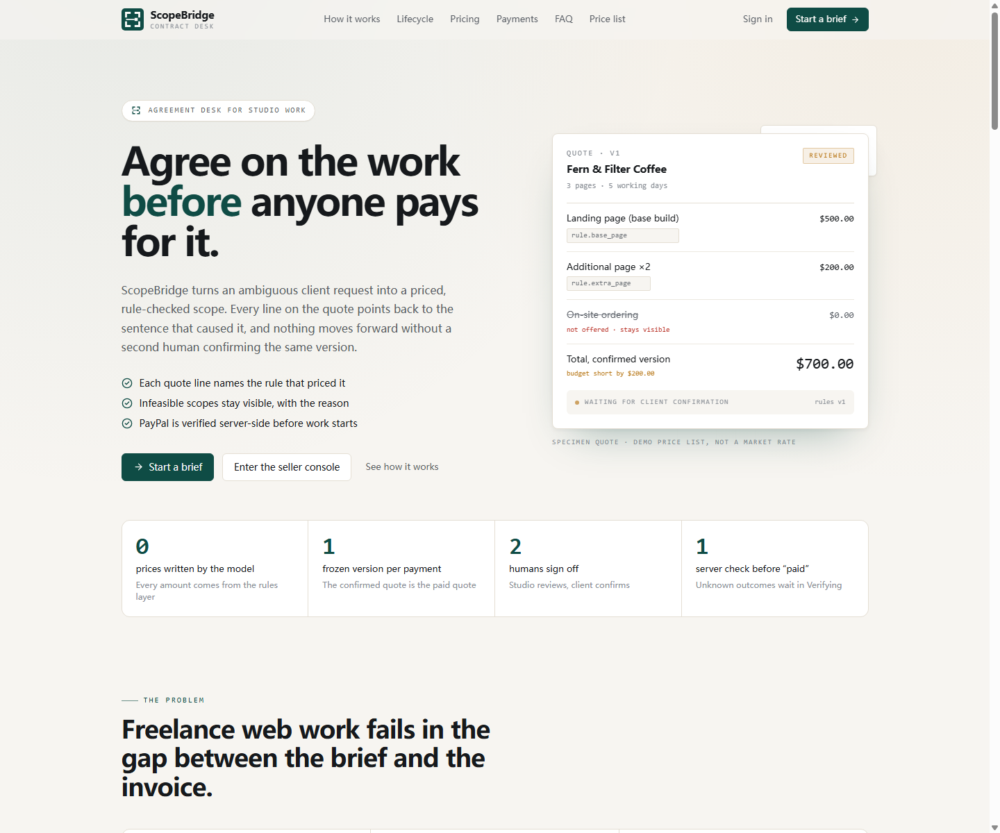

---

## The demo in one paragraph

Maya asks for a three-page site with on-site ordering, a $500 budget, live in two weeks, no assets
ready. The studio prices two scopes: a one-page launch that includes an external ordering link
(within budget) and a two-page option with copywriting ($250 over). The over-budget scope stays on
screen with its exact violation instead of being hidden. Maya picks the feasible scope, the studio
reviews the quote, Maya confirms that version, and the quote becomes read-only. Any new client
message after that creates a new revision and supersedes open drafts — never edits history.

| Seller console | Requirement workspace |
| --- | --- |
| 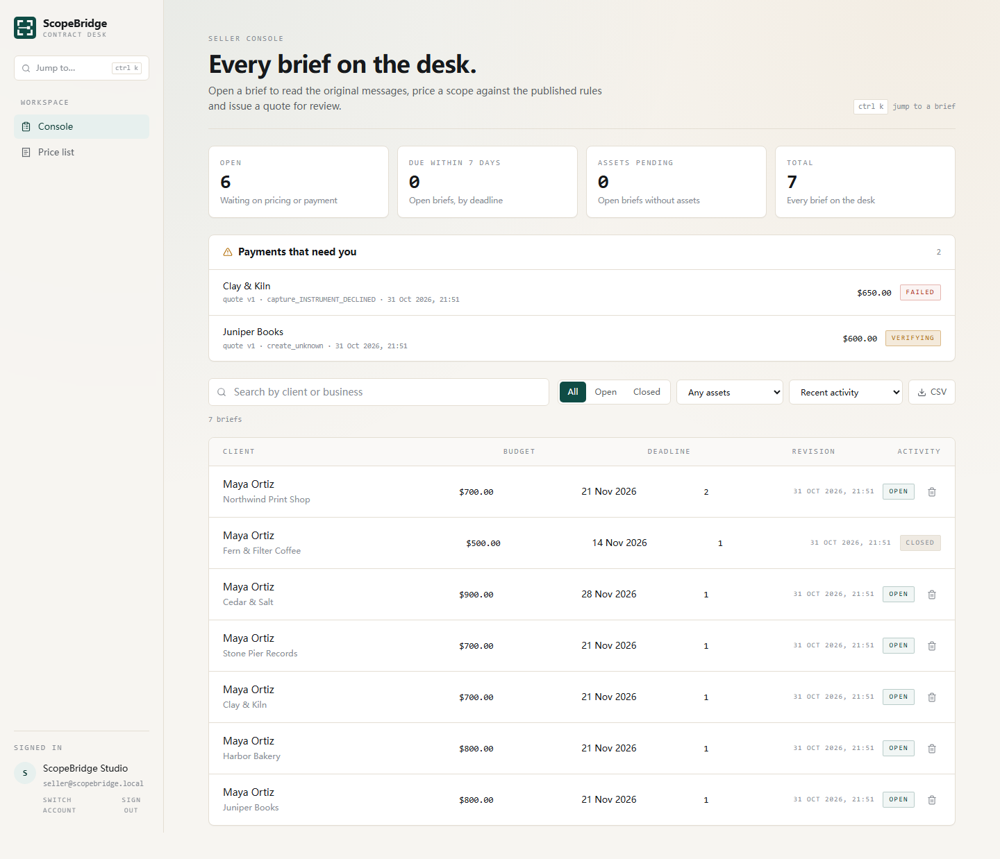 | 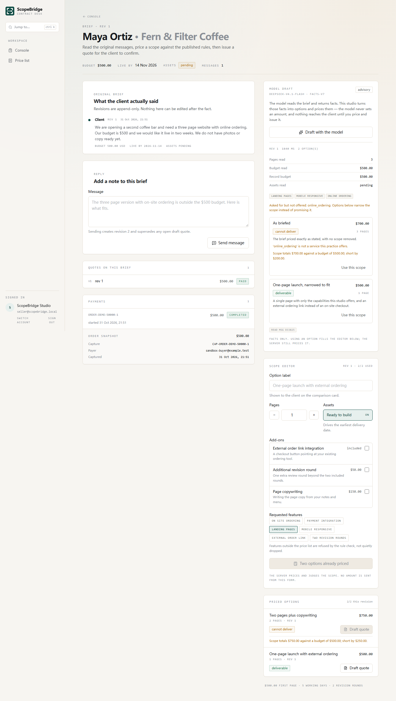 |

| Quote (confirmed) | Client portal |
| --- | --- |
| 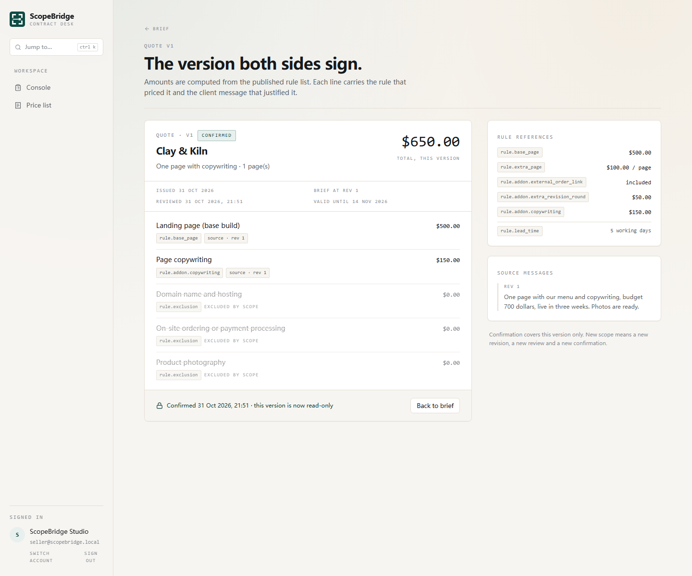 | 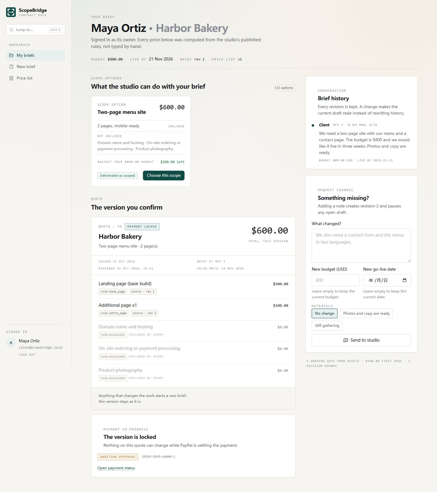 |

| Client portal at 390 px |
| --- |
| 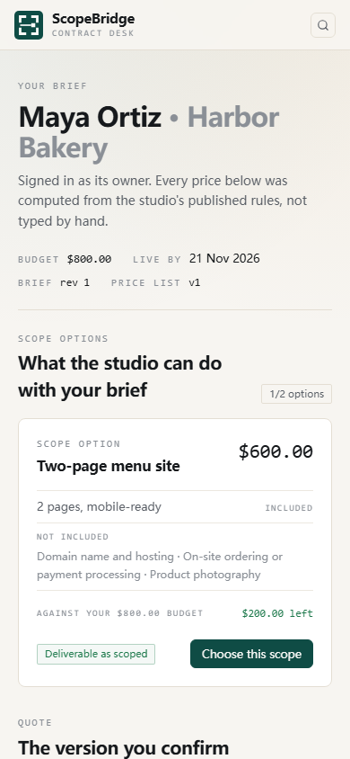 |

---

## What is implemented (M0–M5)

- **Versioned service rules** — base page, extra pages, add-ons, capability list, exclusions and
  lead time are stored as an immutable rule version; historical quotes keep their original numbers.
- **Client-owned intake** — a signed-in client submits a brief; the requirement belongs to that
  account, and ownership checks decide who may read or change it.
- **Revisioned messages** — every append carries `expected_revision`; stale writes return `409`.
- **Rule-checked scopes** — the studio enters a scope (pages, add-ons, requested features, assets),
  and the server prices and judges it. Up to two candidate scopes per revision.
- **Client comparison** — feasible and infeasible scopes side by side, with budget delta, exclusions
  and explicit unsatisfied conditions.
- **Quote versions** — generated from a feasible scope with line items, rule references and source
  message references; `DRAFT → REVIEWED → CONFIRMED`, with `SUPERSEDED` on change.
- **Two seats, one session model** — seller and client each sign in; writes carry CSRF; ownership
  checks decide which briefs an account may read.
- **Model draft (facts only)** — one click sends the brief to an OpenAI-compatible model, which
  returns five facts (`pages`, `budget_usd`, `deadline_days`, `assets_ready`, `features`). The studio
  turns those facts into at most two options and prices them; the model never supplies an amount.
  Every call is stored in `ai_extractions` with model, prompt version, raw output, latency and error.
- **PayPal sandbox payment** — the client confirms a quote, then pays through PayPal Orders v2
  (`create → approve → capture`). The quote is locked before the first external call; the amount is
  read from the confirmed quote on the server; a lost capture response parks the attempt in
  `RECONCILING` until the original order is queried. A successful capture writes an immutable order
  snapshot in the same transaction as the `PAID` transition.
- **Version diff** — when a quote is reissued, the new version shows what changed against the
  previous one, line by line, with the total delta.
- **Structured change requests** — the client can change the brief *and* the budget, deadline or
  material state from the portal; the next quote prices the new record, and a stale revision returns
  `409` without losing what was typed.
- **Recovery when PayPal never answers** — an attempt with no order id can be retried with the same
  `PayPal-Request-Id` (bounded), or closed by the studio after a written check, which unlocks the
  quote and records who closed it and why.
- **Comparative evaluation** — 19 fixed cases run through both a one-shot "model quotes it" arm and
  the facts-and-rules pipeline, with unparseable answers counted as failures.
- **Local-first operation** — PostgreSQL in Docker, single operator account; the model and PayPal are
  the only external services, and the manual path works without the model.

Not implemented yet (planned, see `docs/FORMAL_PROPOSAL.md`): clean-environment reproduction, demo
video and submission material (M6), plus a real user trial; refunds, partial captures and unattended
reconciliation are out of scope for the hackathon build.

| Milestone | Scope | State |
| --- | --- | --- |
| M0 | scaffolding, database, health check | done |
| M1 | pure-function pricing and feasibility | done |
| M2 | requirement → scope → quote → review → confirm | done |
| M3 | model extraction (facts only), server-built options | done |
| M4 | PayPal sandbox create / approve / capture / recovery | done (one real $500.00 payment) |
| M5 | version diff, structured change requests, 19-case evaluation | code complete; real user trial not run |
| M6 | clean-environment reproduction, video, submission | pending |

## Repository map

```text
ScopeBridge/
├─ README.md            English entry point (this file)
├─ REQUIREMENTS.md      hackathon rules this project must satisfy
├─ AGENTS.md            agent rules for this repository
├─ docker-compose.yml   isolated PostgreSQL 18 (host port 55433)
├─ backend/             FastAPI app, rules layer, alembic migrations, pytest
├─ frontend/            Vite + React + TypeScript + Tailwind
├─ evals/               cases.json, run_eval.py, metrics.py, reports/
├─ docs/                design docs, diagrams, demo script, screenshots
└─ .agents/             skills and decision notes (implemented / proposed / archived)
```

- `evals/reports/` keeps every run behind the numbers quoted in this README.
- `.agents/notes/implemented/` keeps the decision notes referenced from the docs.
- `frontend/public/` keeps the brand assets: `favicon.svg` (tab tile) and `logo-mark.svg` (standalone mark).

| Payment on the client portal | Payment history in the console |
| --- | --- |
| 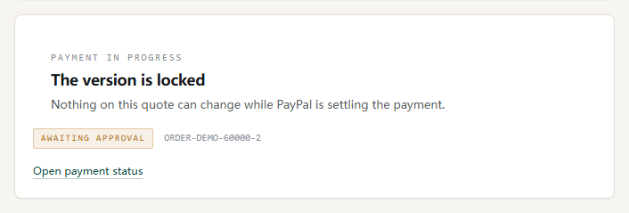 | 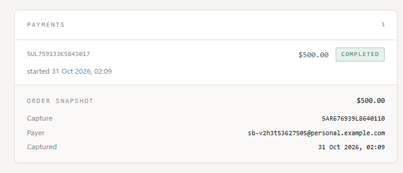 |

| Version diff | Scope estimator |
| --- | --- |
| 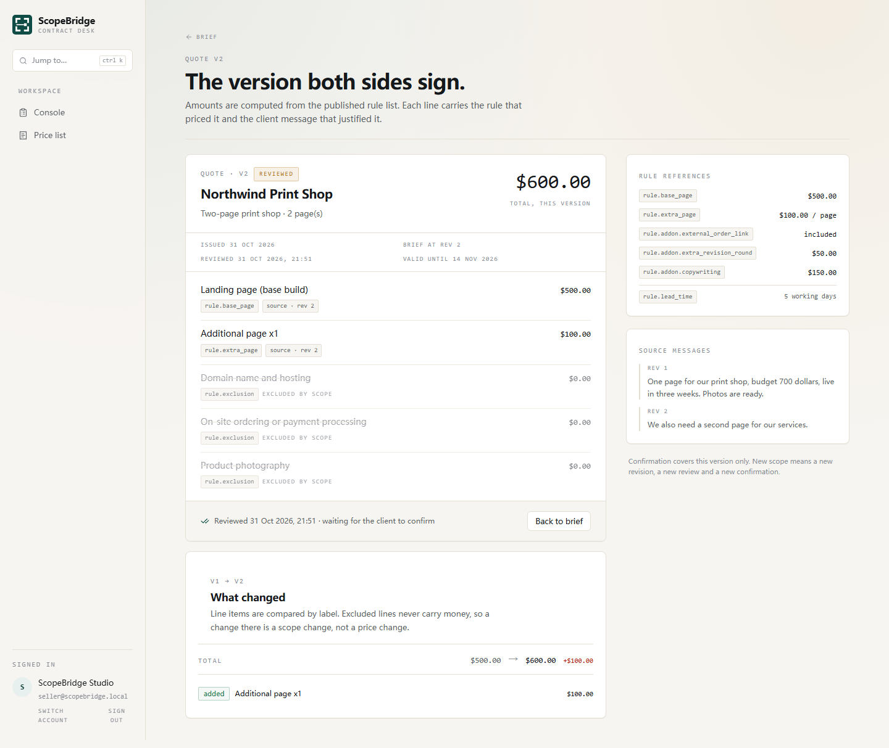 | 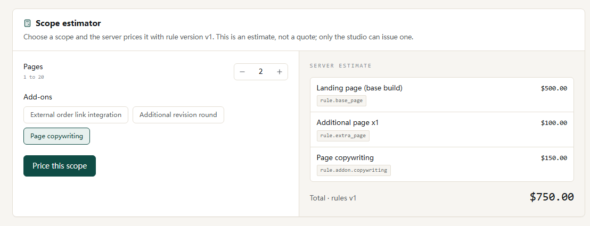 |

| Model draft | Options it produced |
| --- | --- |
| 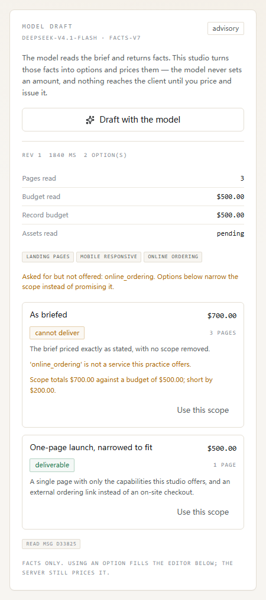 | 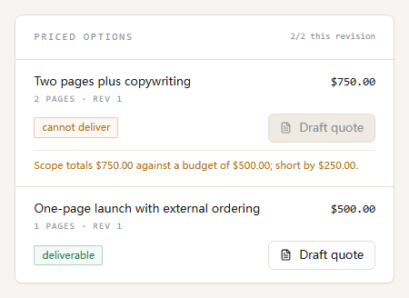 |

**The demo database records this sandbox capture** (order `5UL759133K5843017`, capture `5AR676939L8640110`, $500.00):

| Confirmed on return | Frozen snapshot (client) | Frozen snapshot (console) |
| --- | --- | --- |
| 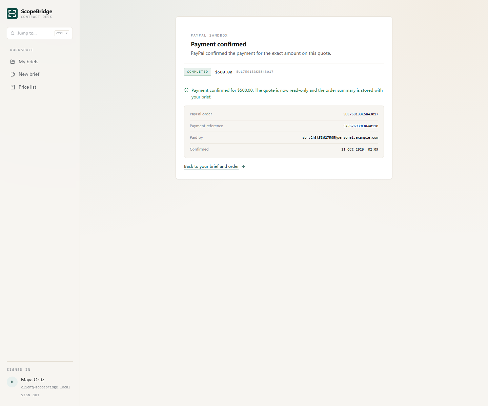 | 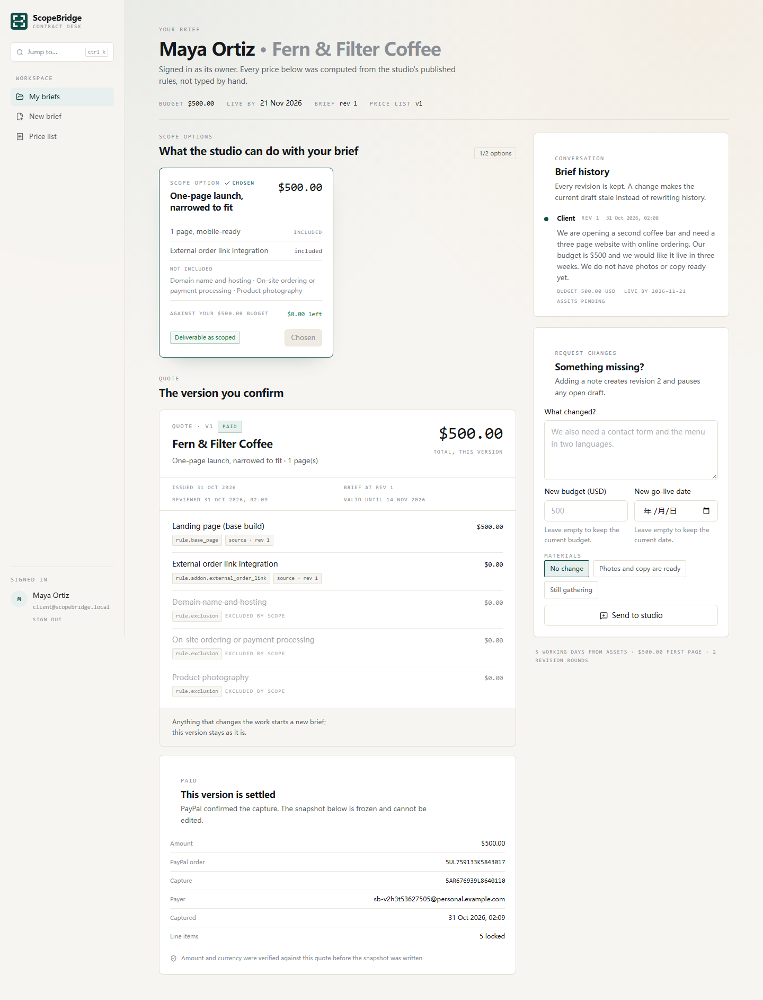 | 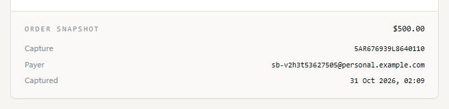 |

**When PayPal never answers** (the sandbox adapter's transport is fault-injected; no external charge):

| Stuck but visible | Recovered with the same request id | Closed by hand |
| --- | --- | --- |
| 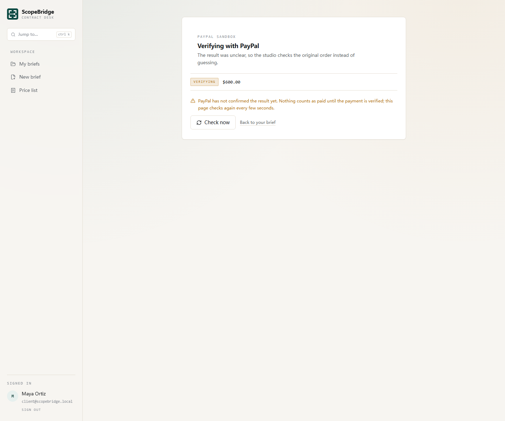 | 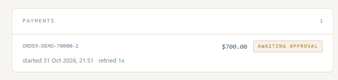 | 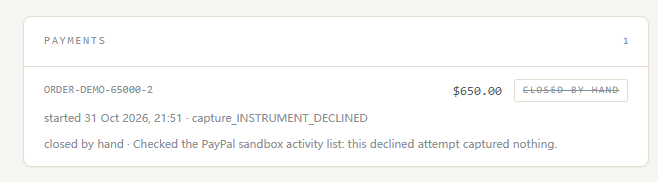 |

| Payment page (demo state) | Awaiting approval (demo state) |
| --- | --- |
| 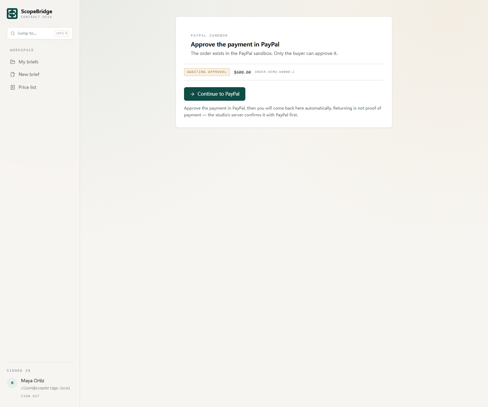 | 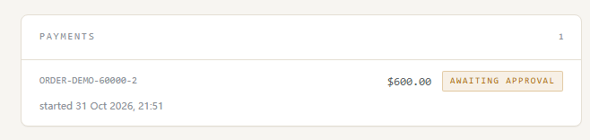 |

| Console attention list | Client briefs with the Closed filter |
| --- | --- |
| 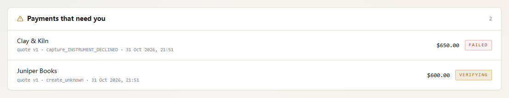 | 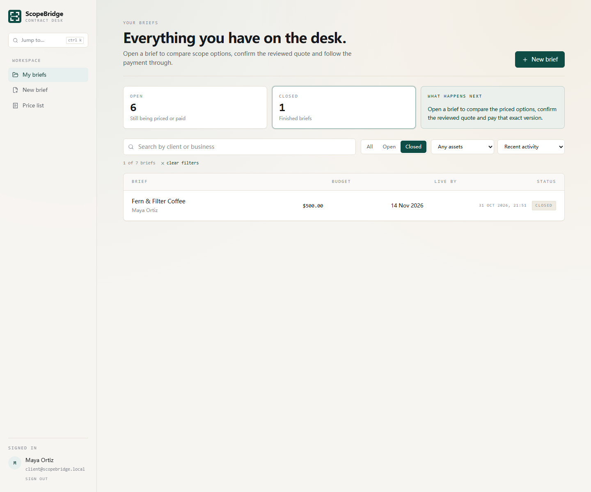 |

| Two seats at one desk | A brief in plain language |
| --- | --- |
| 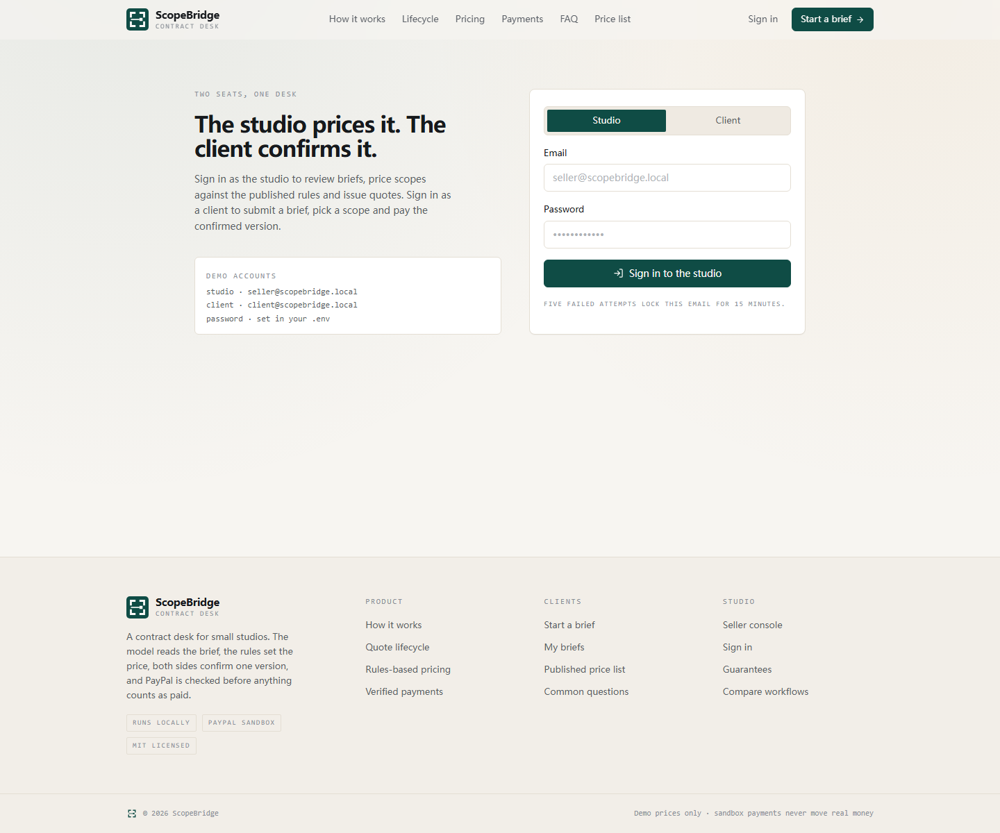 | 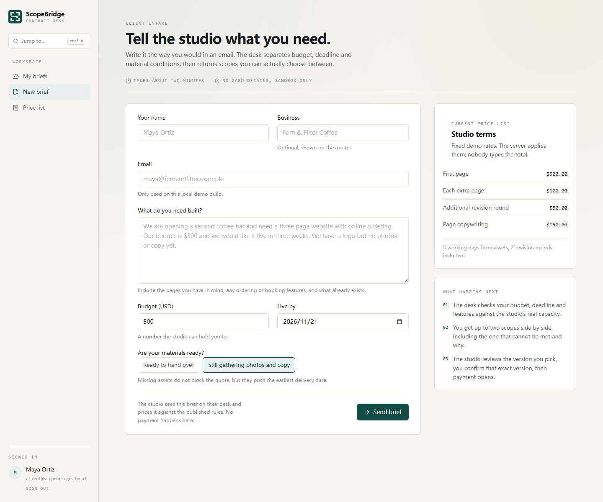 |

Unless a screenshot is named as the real capture above, the images were taken from an isolated
demo dataset; payment-state screenshots (for example 16–18 and 24) were produced with a local
fake adapter during development and the committed build has no fault-injection switch. Only `10`
and `13`–`15` come from the demo database's recorded sandbox capture.

---

## Architecture

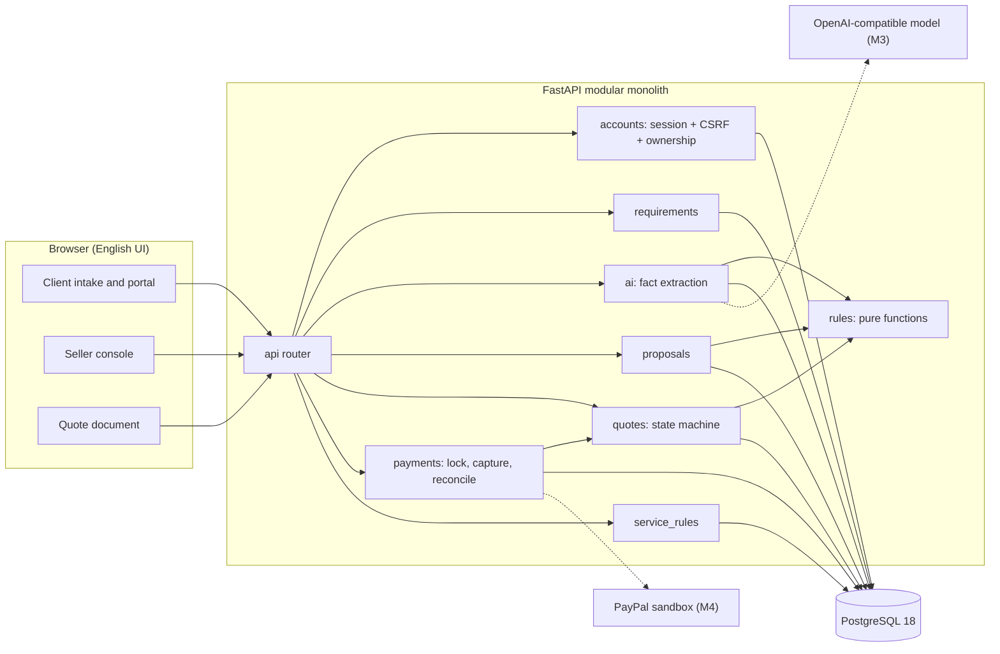

Dependency direction is one-way: `router → service → rules/models`. `app/rules/` has no database,
network or clock access — `today` is passed in — so model output passes through the same functions as
a hand-typed scope.

Money is always integer minor units (cents) in USD. The client never sends a quote or payment
amount; it sends the budget and deadline it wants the studio to work against.

### Model boundary: facts, not proposals

The model returns a five-key fact sheet and nothing else. Anything out of shape is rejected whole and
recorded, never coerced:

```
{"pages": 3, "budget_usd": 500, "deadline_days": 14,
 "assets_ready": false, "features": ["landing_pages", "online_ordering"]}
```

`app/ai/candidates.py` then builds at most two options — "As briefed" and, when that fails, a
one-page scope that keeps only capabilities the studio actually offers — and `app/rules` prices both.
`budget_usd` from the model is displayed as "what the model read"; the authoritative budget comes from
the stored client message.

Measured against this gateway (2026-10-30, `deepseek-v4.1-flash`): asking for a nested object with
candidate scopes matched the schema 0/5 times, `response_format: json_schema` was accepted but not
enforced, and a persona-style prompt produced prose every time. The five-key sheet with a plain-text
brief succeeded 5/5 at 2.1–3.2 s. Reasoning and rejected options:
`.agents/notes/implemented/architecture/2026-10-30-model-boundary-facts-not-scopes.md`.

---

## Run it locally

**Prerequisites:** Docker Desktop, [uv](https://docs.astral.sh/uv/), Node 20+ with pnpm.

```bash
git clone git@github.com:1634594707/ScopeBridge.git
cd ScopeBridge

# 1) environment
cp .env.example .env          # then set DATABASE_URL, SESSION_SECRET, SELLER_PASSWORD
                              # optional: MODEL_BASE_URL / MODEL_API_KEY / MODEL_NAME
                              # APP_BASE_URL must match the origin you open in the
                              # browser (4173 for preview, 5173 for dev): PayPal
                              # sends the buyer back to that exact address.

# 2) database (PostgreSQL 18 on port 55433, isolated from any local instance)
docker compose up -d

# 3) backend
cd backend
uv sync
uv run alembic upgrade head
uv run python -m app.seed     # seller account, rule v1, one demo brief
uv run uvicorn app.main:app --port 8000

# 4) frontend (new terminal)
cd frontend
pnpm install
pnpm dev                      # http://127.0.0.1:5173
```

If `pnpm dev` fails on your machine with esbuild "Access is denied" errors, run the production bundle
instead — it is the same application, served by Vite's preview server:

```bash
cd frontend
pnpm build
pnpm exec vite preview        # http://127.0.0.1:4173
```

### Demo walkthrough

1. **Client** — open `/signin`, choose **Client**, and sign in with the demo client credentials from
   `.env`. Then open `/start`, submit a brief, and land on `/briefs/<id>`.
2. **Studio** — open `/signin`, choose **Studio**, and use the seller credentials from `.env`.
3. Open the brief in `/console`. Optionally press **Draft with the model** to see the extracted facts
   and two priced options; **Use this scope** copies one into the editor. Then **Price this scope**
   and **Draft quote**.
4. On the quote page press **Review and issue**.
5. **Back as the client** — open **My briefs**, choose the scope, press **Confirm this version**.
   The quote turns read-only and the payment card appears.
6. Press **Continue to PayPal**, sign in with a **Sandbox Personal** account from
   <https://developer.paypal.com/dashboard/accounts>, and approve. PayPal returns you to
   `/pay/<payment-id>`, which confirms the payment automatically; the server verifies amount and
   currency, marks the quote `PAID` and writes the order snapshot.

A two-path shooting script (happy path and the "no order id" recovery) is in
[docs/DEMO_SCRIPT.md](docs/DEMO_SCRIPT.md).

## Running without credentials

This path is for a judge who has no model key and no PayPal sandbox credentials. It reaches the UI,
sign-in, briefs, manual scoping, quotes, review and client confirmation. It cannot complete a
payment and cannot call the model; both failures are explicit, not silent.

1. Copy the template and fill only the required values:

   ```powershell
   Copy-Item .env.example .env
   # Fill DATABASE_URL, POSTGRES_PASSWORD, SESSION_SECRET, SELLER_EMAIL/PASSWORD,
   # CLIENT_EMAIL/PASSWORD. Leave MODEL_* and PAYPAL_* empty.
   # APP_BASE_URL must match the browser origin (5173 for dev, 4173 for preview).
   ```

2. Start PostgreSQL and wait for health:

   ```powershell
   docker compose up -d
   docker compose ps
   ```

3. Run the backend:

   ```powershell
   cd backend
   uv sync
   uv run alembic upgrade head
   uv run python -m app.seed
   uv run uvicorn app.main:app --port 8000
   ```

4. Run the frontend in a second terminal:

   ```powershell
   cd frontend
   pnpm install
   pnpm dev          # http://127.0.0.1:5173
   # or: pnpm build; pnpm exec vite preview   # http://127.0.0.1:4173
   ```

5. Open the UI, sign in as the client and studio, submit a brief, use the scope editor manually,
   price a scope, review and issue a quote, and confirm it as the client.

What works without credentials:

- health, sessions, CSRF, ownership checks, briefs, manual scope pricing, quote versions, review,
  confirmation, estimator and the closed/paid read-only rules;
- `uv run pytest -q` and `scripts/verify.ps1` use test placeholders and a fake PayPal adapter; they
  do not need real credentials.

What stops, and how it is reported:

- **Model draft**: `POST /api/requirements/{id}/extractions` returns
  `503 {"code":"model_not_configured"}` with the message "Set MODEL_API_KEY and MODEL_NAME in .env
  to draft with the model." The UI shows this on the model card; the manual scope editor remains.
- **Payment**: `POST .../payment-attempts` returns `503 {"code":"paypal_not_configured"}` before
  locking the quote. The quote stays `CONFIRMED`, the UI shows the message, and no attempt is
  created. There is no way to reach the PayPal approval page without sandbox credentials.

So the judge can evaluate the product and rule layer without credentials, but a real sandbox
payment needs `PAYPAL_CLIENT_ID` / `PAYPAL_CLIENT_SECRET`. This is a working prototype, not a
hosted demo.

Try an infeasible scope too: three pages against a $500 budget returns
`Scope totals $700.00 against a budget of $500.00; short by $200.00.`

To demonstrate recovery without editing `.env`, start the API with a process-level
`PAYPAL_TIMEOUT_SECONDS=0.05`, then start a payment from the client page. The create call times out,
so the attempt appears as `RECONCILING` (shown as **Verifying** in the UI) with `create_unknown` and
no order id. Stop the API, set `PAYPAL_TIMEOUT_SECONDS=30` in the same terminal, start it again, and
in the seller console press **Retry create**; PayPal replays the same `PayPal-Request-Id` and returns
the order it may already have made. If the retry still returns no order id after two attempts, press
**Close**, write what you checked in PayPal, and the quote returns to `CONFIRMED`.

---

## API surface

| Method | Path | Who |
| --- | --- | --- |
| `POST` | `/api/session` · `/api/client-session` · `GET /api/session` · `DELETE /api/session` | seller / client sign-in, session read, sign-out (CSRF) |
| `POST` | `/api/clients` | public — client registration, opens the first session |
| `GET` | `/api/service-rules` | public |
| `POST` | `/api/service-rules/estimate` | public — prices a scope from pages + add-on codes only |
| `POST` | `/api/requirements` | client (CSRF); the brief is owned by the signed-in client |
| `GET` | `/api/requirements` · `/api/requirements/{id}` | seller |
| `DELETE` | `/api/requirements/{id}` | seller (CSRF); 409 once an order snapshot exists or an attempt is non-terminal/has a PayPal id |
| `POST` | `/api/requirements/{id}/messages` | seller (CSRF) |
| `POST` | `/api/requirements/{id}/extractions` · `GET .../extractions/latest` | seller (CSRF) |
| `POST` | `/api/requirements/{id}/proposals` | seller (CSRF) |
| `POST` | `/api/requirements/{id}/quotes` | seller (CSRF) |
| `POST` | `/api/quotes/{id}/review` | seller (CSRF) |
| `GET` | `/api/portal/briefs` | client — the client's own briefs |
| `GET` | `/api/portal/{requirement_id}` · `POST .../messages` | client + ownership |
| `POST` | `/api/portal/requirements/{requirement_id}/proposals/{id}/select` | client + ownership (CSRF) |
| `POST` | `/api/portal/requirements/{requirement_id}/quotes/{id}/confirm` | client + ownership (CSRF) |
| `POST` | `/api/portal/requirements/{requirement_id}/quotes/{id}/payment-attempts` | client + ownership (CSRF) + `Idempotency-Key` |
| `GET` | `/api/portal/payments/{id}` · `POST .../capture` | client + ownership (capture: CSRF) |
| `POST` | `/api/payments/{id}/reconcile` · `/retry-create` · `/close` | seller (CSRF) |
| `GET` | `/api/payments/attention` | seller — `RECONCILING` / `FAILED` on quotes not yet `PAID` |
| `GET` | `/api/requirements/{id}/payments` · `/order` | seller |
| `GET` | `/api/orders/{id}` | seller |
| `GET` | `/api/health` | public |

Errors are always `{"code", "message", "details?"}` — no stack traces, SQL or tokens.

---

## Tests

```bash
cd backend
uv run pytest -q            # 109 tests
uv run ruff check .
```

For an isolated, one-command clean run (independent compose project and volume), use
`scripts/verify.ps1` or `scripts/verify.sh`. Path B demo data is prepared with
`scripts/prepare-demo-pathb.ps1`; both are documented in `docs/M6_RUNBOOK.md`.

Platform note: `scripts/verify.ps1` is the end-to-end verified path on Windows. `scripts/verify.sh`
was syntax-checked with `bash -n` in a Linux container but not executed end-to-end here; the
`.github/workflows/verify.yml` workflow is added for `ubuntu-latest` but has not run yet.

- `test_pricing.py` / `test_feasibility.py` — pure rule layer (three pages = 70000 cents, budget gap,
  unsupported capability, lead time, missing information).
- `test_state_machine.py` — key illegal quote transitions return `409`, and a confirmed quote is
  superseded by a brief change.
- `test_api_auth.py` — bad password, throttling, CSRF, two-sided sign-in and cross-account access.
- `test_api_service_rules_estimate.py` — the public estimator prices from the rule version, refuses
  client-supplied amounts and reports unknown add-ons.
- `test_api_quote_flow.py` — intake → scope → select → quote → review → confirm, revision
  supersession, seller messages preserving client facts, and asset assumptions.
- `test_eval_cases.py` — replays the 19 fixed validation cases in `evals/cases.json`.
- `test_ai_extraction.py` — server-built options, model money ignored, prose/extra keys/out-of-range
  pages rejected, evidence row written, empty latest draft returns `null`.
- `test_api_payment.py` — quote lock on attempt, idempotency replay and conflict, capture writes one
  snapshot, amount mismatch stays in `RECONCILING`, lost response recovered by reconcile, declined
  capture unlocks the quote, capture after a decline is recorded as paid, stale `CREATING`/`CAPTURING`
  attempts are parked, PayPal-missing config does not lock, in-flight attempts block deletion,
  expired/revision-changed quotes cannot start payment, closed briefs reject new work, and cross-tenant
  access returns 404.
- `test_api_errors.py` — health and unexpected failures use the same `{code, message}` envelope and do
  not echo exception text.

Fixture cases live in `evals/cases.json` (20 cases, 19 of them rule-level) with their expected
verdicts; changing a rule means updating the case first, not loosening the assertion.

### Comparative evaluation

```bash
cd backend
uv run python ../evals/run_eval.py --runs 3 --workers 1 --timeout 120 --pause 2
```

Two arms, same briefs, same published terms, same model:

- **baseline** — one prompt asks the model for pages, add-ons, a total and a feasibility claim. The
  claimed total is compared with what the rules would charge for the scope it named.
- **pipeline** — the model returns the five facts, the server builds at most two options and prices
  them.

Reports land in `evals/reports/<timestamp>.{json,md}` with per-case verdicts, average and p95 latency,
and token counts. Nothing in the report is estimated: failed calls are counted as failures.

Every rate names its denominator. `all attempts` includes unparseable and failed calls; `parsed`
is used only where the label says so. Pipeline "unsafe releases" is not assumed to be zero: each
option's displayed price and verdict are re-computed from the rules and mismatches are counted.

Latest recorded run (`evals/reports/20261030T151055Z-facts-v7-inline-both.md`, 19 cases, one run
each, sequential):

| metric | baseline | pipeline |
| --- | --- | --- |
| parse rate | 18 / 19 | 19 / 19 |
| transport failures | 1 | 0 |
| claims the rules reject | 2 | n/a |
| wrong or missing price | 0 of the parsed | n/a (server prices) |
| unsafe releases (measured) | 2 | 0 |
| original request satisfied | n/a | 6 |
| narrowed option available | n/a | 6 |
| honest "no solution" | n/a | 7 |
| average latency | 4.3 s | 4.3 s |

An earlier run of the same harness (`20261030T132147Z.md`) had only 7/19 pipeline answers parse.
The cause was not the wording but the channel: this gateway did not deliver the system message, so
the contract never reached the model. The contract is now sent with the payload as well; parse rate
went from 47% to 100% on the same cases, and the change is recorded in
`.agents/notes/implemented/architecture/2026-10-30-contract-must-travel-with-payload.md`.

---

## Engineering notes

- **Modular monolith** with domain packages (`accounts`, `service_rules`, `requirements`,
  `proposals`, `quotes`); cross-package calls go through services, never through another package's
  tables.
- **Pure decision layer** (`app/rules/`): pricing and feasibility are functions of `(RuleSet,
  ScopeInput)`, with `today` injected, so verdicts are reproducible and unit-testable without a
  database.
- **Revision CAS instead of locks**: `expected_revision` guards appends; quotes are immutable once
  created, and a new revision supersedes open drafts.
- **Decision notes** live in `.agents/notes/` (`implemented/architecture/`), including a STRIDE pass
  over sessions, ownership checks and CSRF. Workflow rules for this repo are in `AGENTS.md`.
- **Model boundary**: `app/ai/client.py` is the only place that speaks HTTP to a model; failures are
  surfaced as `502`, invalid shapes as `422`, and every attempt (including failures) is stored in
  `ai_extractions` with its prompt version.
- **Payments lock before they call out**: `app/payments/service.py` commits the attempt and the
  `PAYMENT_LOCKED` state before touching PayPal, then only a verified `COMPLETED` capture can write the
  snapshot and move the quote to `PAID`. See
  `.agents/notes/implemented/architecture/2026-10-30-payment-lock-and-verify.md`.
- **Secrets** stay in `.env` (git-ignored). The PayPal sandbox credentials used during development are
  not part of the repository; only `.env.example` is tracked.

### Known limitations

- `POST /api/requirements` and `POST /api/clients` have no rate limit; add one before exposing the
  app publicly.
- There is no Playwright/E2E suite in this build. The browser flow is verified by the manual demo
  script and the API tests; the frontend build is type-checked.
- Quote immutability is enforced in the application layer, not by database triggers.
- No audit log beyond message authorship, revisions, quote timestamps, model calls and payment
  attempts.
- Model calls are single-attempt: an invalid answer costs one click and returns `422`; the studio
  prices by hand. No automatic repair prompt or retry, so failures stay visible in the evidence table.
- `features` come back as free strings; codes that are not capabilities appear under
  "asked for but not offered" instead of being mapped silently.
- Payments are sandbox-only. There are no webhooks: an unclear capture is resolved by the seller
  pressing **Verify with PayPal**, retrying the create call, or closing the attempt with a written
  note. A `CREATING` or `CAPTURING` attempt left by a process stop is parked in `RECONCILING` by
  startup/request-time recovery after 120 seconds; there is no background watchdog. Closing a quote
  unlocks it only after that human check, so a quote can stay `PAYMENT_LOCKED` until someone acts.
- A paid brief is terminal: later messages, proposals and quotes are rejected. New work needs a new
  brief. A confirmed quote is superseded when a later brief revision arrives.
- Closing an attempt is a human judgement; the server cannot prove that PayPal has no order. The
  note and the resolving seller are stored on the attempt for review.
- No refunds, partial captures or unattended reconciliation job. `PAYPAL_MERCHANT_ID` is optional; when
  unset only amount and currency are verified, not the payee.
- The demo price list is fictional; it is a product fixture, not a market rate.

## License

MIT — see [LICENSE](LICENSE).
